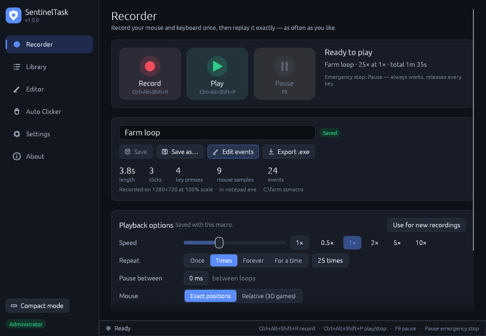
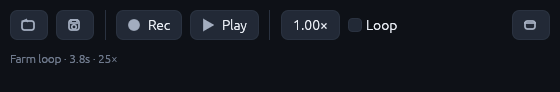
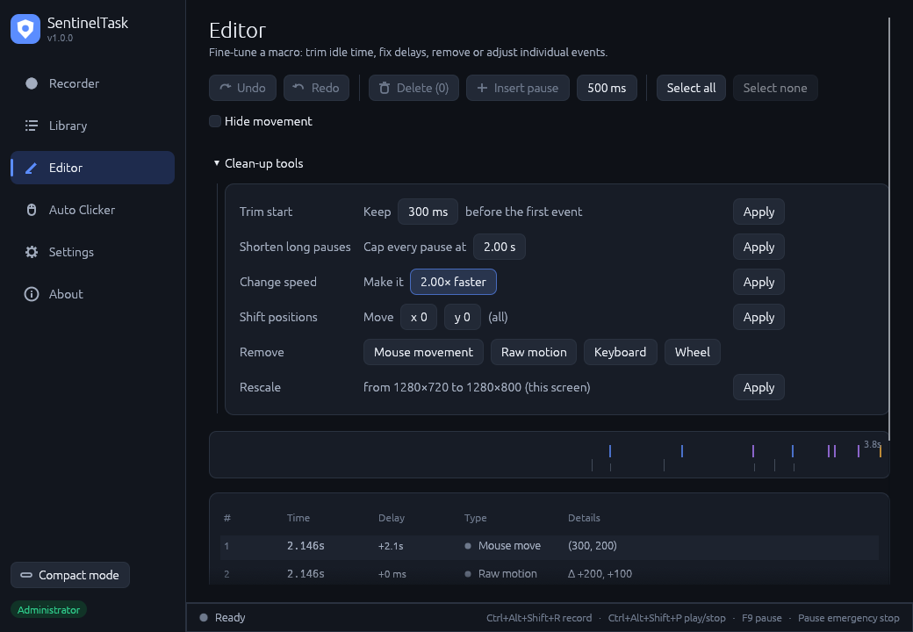
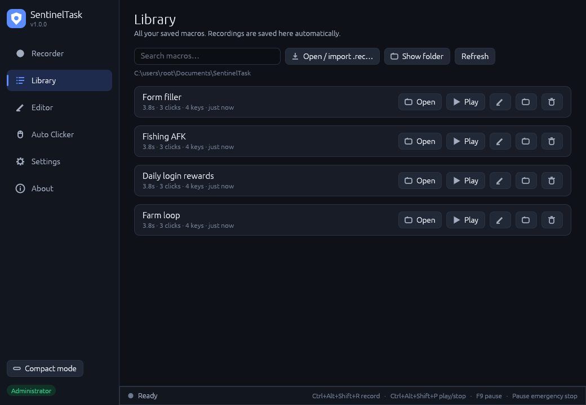
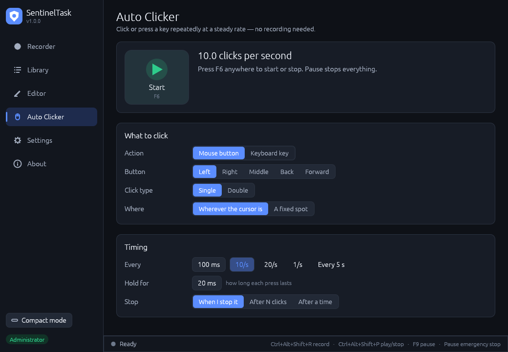
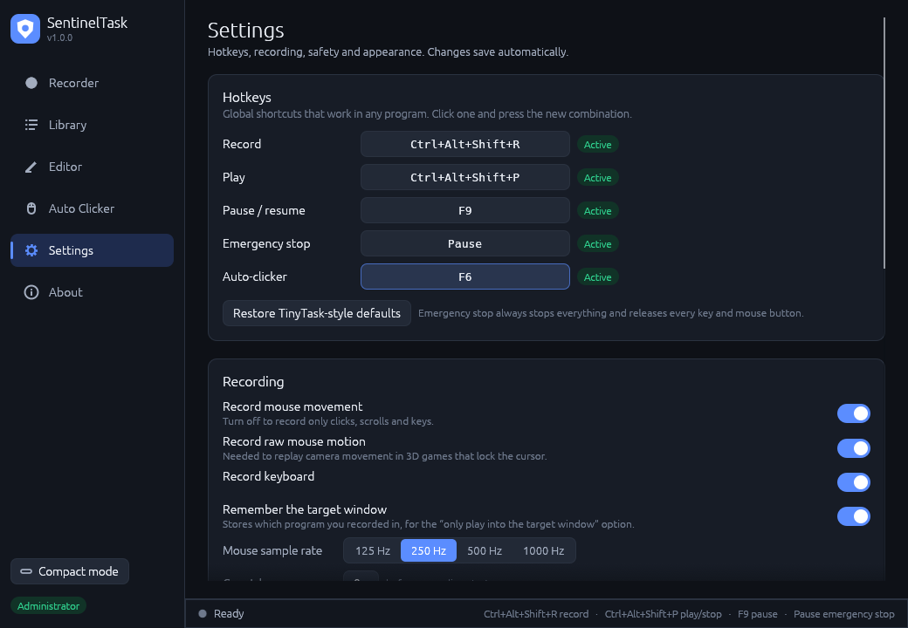

<p align="center">
  
</p>

<h1 align="center">SentinelTask</h1>

<p align="center">
  <b>A modern, reliable successor to TinyTask.</b><br>
  Record your mouse and keyboard once — replay it exactly, as often as you like.
</p>

<p align="center">
  
</p>

SentinelTask keeps what people love about TinyTask — one click to record, one
click to play, a single portable `.exe` — and fixes the things that made it
unreliable for long runs and games. Every design decision comes from
researching TinyTask's known problems and the Windows APIs behind them; the
full write-up is in [`docs/RESEARCH.md`](docs/RESEARCH.md).

## Why it's better than TinyTask

| TinyTask problem | What SentinelTask does |
|---|---|
| Clicks land in the wrong place on 125 % / 150 % scaling or a second monitor | Per-monitor DPI aware; positions stored in physical pixels with the screen layout; multi-monitor and negative coordinates handled exactly |
| Doesn't work in many games | Keys sent as **hardware scan codes** (what DirectInput/Raw Input games read); **Relative mouse mode** replays raw motion for 3D cameras — auto-detected when the cursor was locked |
| Keys or mouse buttons stay stuck down | Everything held is tracked and **released on stop, pause, error, crash and exit**; recordings are normalised so every press has a release |
| Long loops drift and slow down | Every event has an absolute deadline (no accumulated error) and a high-resolution waitable timer; if the PC stalls, timing re-syncs instead of firing a burst of clicks |
| Hotkey keystrokes / Stop-button clicks end up in the macro | The stop chord is stripped precisely; clicks on SentinelTask itself are never recorded; replayed input is never re-recorded |
| Nothing happens in apps running as administrator | Detects the elevated target window and offers **Restart as administrator** |
| PC sleeps or screen turns off during an overnight run | Keeps the PC and display awake while playing |
| Macro clicks the wrong window after you alt-tab | Optional **focus guard**: pauses while the target program isn't in front, resumes when it is — re-pressing any held keys |
| Fixed hotkeys, conflicts with other apps | Every hotkey rebindable (single keys like F8 work), with conflict detection |
| Can't edit a recording | Full **editor**: timeline, per-event delays and positions, trim idle time, cap long pauses, remove movement, rescale to a new screen, undo/redo |
| Mouse jumps to a corner during keyboard-only macros | The mouse is only touched if the macro contains mouse events |
| Recording silently stops on a busy PC | Hook callbacks return instantly (Windows removes slow hooks without warning) and hooks are reinstalled for every session |

## Features

- **Record & play** with global hotkeys (TinyTask defaults: `Ctrl+Alt+Shift+R` / `Ctrl+Alt+Shift+P`)
- **Pause / resume** (`F9`) and an always-available **emergency stop** (`Pause` key)
- **Speed** 0.1×–100×; **repeat** once, N times, forever, or *for a duration*; pause between loops; "stop after this loop"
- **Library** of macros — recordings are auto-saved so nothing is lost
- **Editor** with timeline, event table, multi-select, undo/redo and clean-up tools
- **Auto Clicker**: any mouse button or key, single/double, fixed spot or cursor, by count or time (`F6`)
- **Click-through status overlay** that never steals clicks or focus
- **Compact mode**: a tiny always-on-top toolbar, like TinyTask

  
- **Import TinyTask `.rec` files**
- **Export a standalone `.exe`** player for a macro (TinyTask's "Compile EXE")
- **Command line** for scripts and Windows Task Scheduler
- **Portable mode**, dark & light themes, UI zoom
- Optional safety stops: stop when you touch the mouse or keyboard
- Readable, versioned JSON macro files (`.stmacro`)

<p>
  
  
  
  
</p>

## Getting started

1. Download one of these from the latest release (or the latest successful
   **CI** run's *SentinelTask-setup-and-zip* artifact):
   - **`SentinelTask-<version>-setup.exe`** — installer. Per-user, no
     administrator rights needed; adds Start menu / desktop shortcuts and lets
     you double-click `.stmacro` files. Uninstall from *Settings → Apps*; your
     macros are kept.
   - **`SentinelTask-<version>-portable.zip`** — unzip anywhere and run
     `SentinelTask.exe`. Settings and macros stay in that folder (delete
     `portable.txt` to store them in your profile instead).
2. Press **Record** (or `Ctrl+Alt+Shift+R`), do what you want automated, then
   press it again to stop. The recording is saved to your library automatically.
3. Press **Play** (or `Ctrl+Alt+Shift+P`). Choose speed and repeat options on
   the Recorder page. Press `Pause` at any time to stop everything.

**Tips**

- **3D games:** if the camera doesn't turn on playback, choose
  *Mouse → Relative (3D games)*. SentinelTask switches automatically when it
  detects a locked cursor during recording.
- **Run as administrator** only if the program you automate runs as
  administrator — SentinelTask tells you when that's the case.
- **Different screen?** Turn on *Fit to current screen*, or use the editor's
  *Rescale* tool.
- **Portable:** create an empty file named `portable` next to
  `SentinelTask.exe` to keep settings and macros beside it (e.g. on a USB stick).

## Command line

```text
SentinelTask.exe                         open the app
SentinelTask.exe macro.stmacro           open a macro (or a TinyTask .rec)
SentinelTask.exe play macro.stmacro --loops 10 --speed 2
SentinelTask.exe play macro.stmacro --for 2h --delay 500
SentinelTask.exe record out.stmacro --seconds 30
SentinelTask.exe info macro.stmacro
SentinelTask.exe convert old.rec new.stmacro
```

Headless playback honours the emergency-stop hotkey and `Ctrl+C`, and always
releases held keys before exiting.

## Building from source

Requires [Rust](https://rustup.rs) 1.85 or newer.

```bash
cargo build --release
```

The executable is `target/release/SentinelTask.exe`. To build the portable
zip and the installer into `dist/` (needs `zip` and `nsis`):

```bash
packaging/make-dist.sh                      # cross-compiles with MinGW
packaging/make-dist.sh path/to/SentinelTask.exe
```

Run the tests with:

```bash
cargo test --workspace
```

Cross-compiling from Linux works with MinGW
(`rustup target add x86_64-pc-windows-gnu`, `apt install mingw-w64`, then
`cargo build --release --target x86_64-pc-windows-gnu`). On non-Windows
systems the app builds with a stub backend that shows the UI but records and
plays nothing — useful for development.

### Project layout

| Path | What's there |
|---|---|
| `crates/sentinel-core` | Platform-independent engine: macro model, `.stmacro` format, TinyTask `.rec` import, drift-free scheduler, recording clean-up, editing, settings. Fully unit-tested. |
| `crates/sentineltask/src/platform/windows.rs` | Low-level hooks, Raw Input, `SendInput`, high-resolution timers, hotkeys, elevation, keep-awake |
| `crates/sentineltask/src/engine` | Playback, recording and auto-clicker threads |
| `crates/sentineltask/src/ui` | The egui interface |
| `docs/RESEARCH.md` | The research behind every design decision |

## Antivirus warnings

Any program that records and replays keystrokes can look like a keylogger to
heuristic antivirus engines, and unsigned executables are treated with extra
suspicion — TinyTask has the same problem. SentinelTask is open source and its
release binaries are built by GitHub Actions from this repository, so you can
verify exactly what you run or build it yourself. Exported standalone players
are just `SentinelTask.exe` with a JSON macro appended.

## Responsible use

SentinelTask automates *your own* mouse and keyboard. Many online games
prohibit automation in their terms of service — check the rules before using
it there. SentinelTask deliberately contains no anti-cheat evasion.

## License

[MIT](LICENSE)
